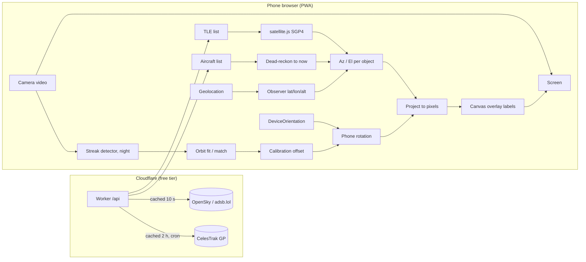

# 03 Architecture

Back to [[00 Home]]

## Pipeline (one frame)

## Components
| Component | Runs where | Note |
|---|---|---|
| Static site (HTML/JS) | Cloudflare Pages | [[13 Cloudflare Hosting]] |
| `/api/aircraft?lat&lon&r` | Hono API: Node.js locally, Cloudflare Worker in production | Proxies OpenSky (hides credentials, adds CORS, caches). See [[04 Data Source - ADS-B Aircraft]] |
| `/api/tle?group=visual` | Cloudflare Worker + Cron + KV/Cache | Respects CelesTrak's rate limits. See [[05 Data Source - Satellites TLE]] |
| Geo math | Phone (JS) | [[06 Math - Positions to Az El]] |
| SGP4 | Phone (JS, Web Worker thread) | [[07 Math - SGP4 Propagation]] |
| Projection + render | Phone (Canvas 2D or Three.js) | [[08 Phone Sensors and Camera Projection]] |
| Calibration | Phone | [[09 Calibration]] |
| Streak detection | Phone (OpenCV.js or hand-written JS) | [[10 Night Mode Orbit Fit]] |
| Eval logger | Phone → download JSON | [[11 Accuracy Evaluation]] |

## Update rates
- Sensors + render: **every frame** (60 Hz)
- Satellite positions: recompute **every frame** for visible ones (SGP4 is cheap: ~thousands/frame OK), all others at 1 Hz
- Aircraft data fetch: **every 10–15 s**, dead-reckoned in between using speed + track + vertical rate
- TLE fetch: **once per session** (cached in the browser for 12 h)

## Why no backend server?
Everything heavy runs on the phone. The Worker exists only to (a) avoid CORS problems, (b) hide the OpenSky API credentials, (c) cache so we never hit rate limits. That keeps everything on the **free tier**, see [[12 Platforms and Cost]].

Tech choices: [[17 Tech Stack]]
